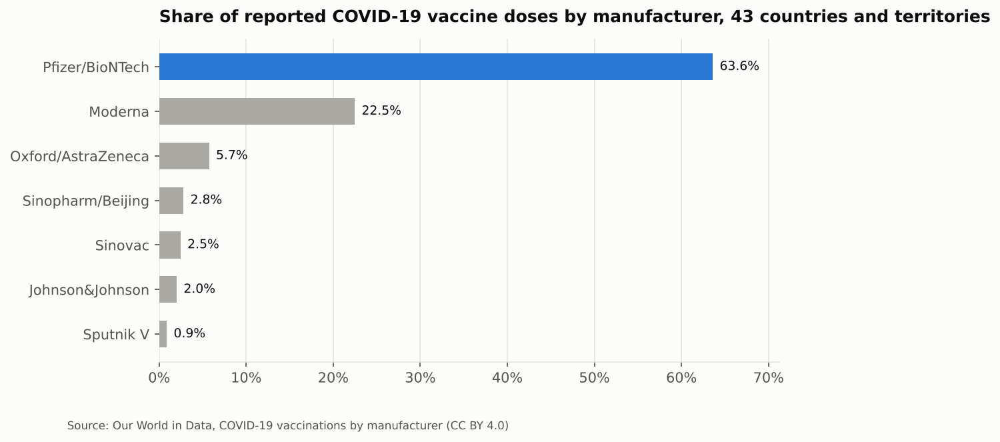
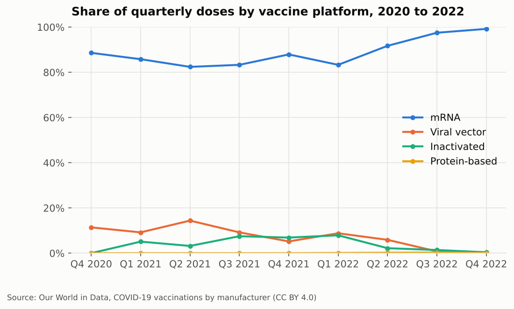
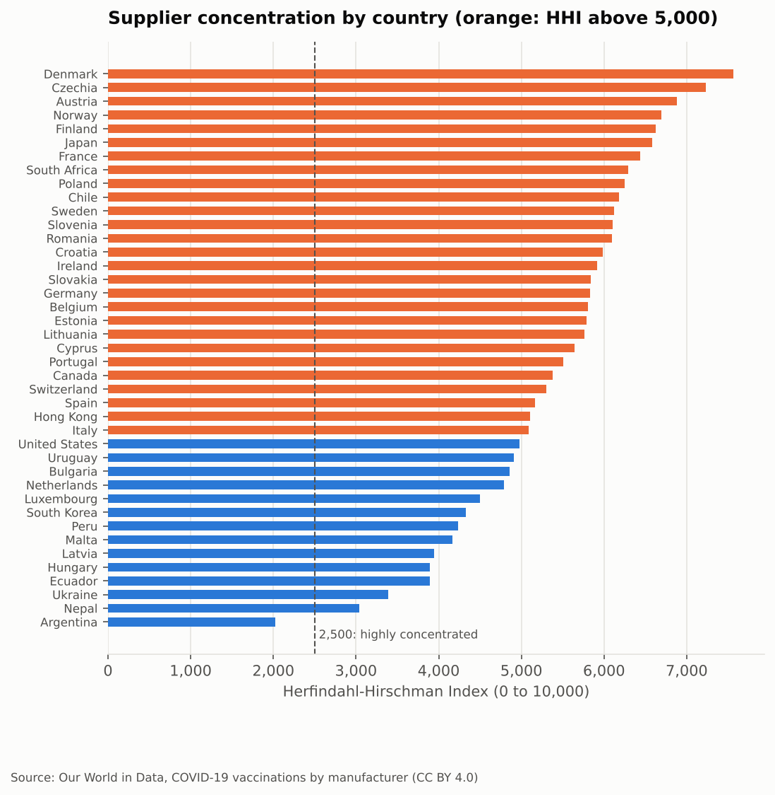

# Biopharma Market Analysis: COVID-19 Vaccine Manufacturer Share

Market share, platform mix, and supplier concentration analysis of 2.6 billion reported COVID-19 vaccine doses across 43 countries and territories, built with SQL (DuckDB) and Python.

| | |
|---|---|
| **Industry** | Biopharmaceuticals |
| **Tools** | SQL (DuckDB), Python, pandas, matplotlib |
| **Techniques** | Data quality profiling, window functions, cumulative-to-incremental conversion, market share, Herfindahl-Hirschman Index |
| **Data** | Our World in Data, vaccinations by manufacturer (68,509 rows, Dec 2020 to Aug 2024) |

---

## 1. Business Questions

1. Which manufacturers supplied the largest share of doses?
2. How did the mix of vaccine platforms (mRNA, viral vector, inactivated, protein-based) change over time?
3. How concentrated was each country's supply on a single manufacturer?

## 2. Key Findings

| # | Finding | Evidence |
|---|---|---|
| 1 | Two mRNA manufacturers supplied 86% of all reported doses. | Pfizer/BioNTech 63.6%, Moderna 22.5% |
| 2 | Pfizer/BioNTech was the only manufacturer used in all 43 reporting countries. | `outputs/tables/02_manufacturer_share.csv` |
| 3 | mRNA share rose from 82% to 99% of quarterly doses between Q2 2021 and Q4 2022 as viral vector and inactivated vaccines exited. | `outputs/tables/03_platform_by_quarter.csv` |
| 4 | 40 of 41 countries with at least 1M doses were highly concentrated (HHI above 2,500); 27 were above 5,000. | `outputs/tables/04_country_concentration.csv` |
| 5 | Argentina had the most diversified supply (HHI 2,023, 7 manufacturers). Chile, Ecuador, Nepal and Argentina were led by inactivated vaccines (Sinovac or Sinopharm). | Same table |
| 6 | Protein-based vaccines (Novavax, Sanofi/GSK) reached 24 countries but stayed under 0.1% of doses. | Same tables |

**Business implication:** Supply in most markets depended on one supplier. For a procurement or market-access team, this indicates high single-source risk and a narrow window for later entrants, regardless of how widely they were approved.

## 3. Results

### 3.1 Manufacturer share



### 3.2 Platform mix over time



### 3.3 Supplier concentration by country



## 4. Method

| Step | File | Description |
|---|---|---|
| Staging | `sql/00_staging.sql` | Loads raw data, removes the European Union aggregate, maps each vaccine to a platform, converts cumulative counts to period increments with `LAG()` |
| Data quality | `sql/01_data_quality.sql` | Row counts, nulls, duplicate keys, downward revisions, unmapped values |
| Market share | `sql/02_manufacturer_share.sql` | Latest cumulative doses per country and manufacturer, share of total |
| Trend | `sql/03_platform_by_quarter.sql` | Quarterly increments and share of quarter by platform |
| Concentration | `sql/04_country_concentration.sql` | Lead manufacturer, mRNA share, and HHI per country |
| Output | `src/run_analysis.py` | Runs the pipeline, writes CSV tables and figures |

## 5. Data Quality

| Check | Result |
|---|---|
| Raw rows | 68,509 |
| Rows after removing EU aggregate | 54,814 |
| Null dose values | 0 |
| Duplicate country-date-vaccine keys | 0 |
| Downward revisions in cumulative series | 4 (increments floored at zero) |
| Unmapped manufacturers | 0 |

The source file includes a "European Union" row set that aggregates member states already present. Including it would double count about 900 million doses, so it is excluded at staging.

## 6. Limitations

- Coverage is limited to countries that report doses by manufacturer. Results describe these 43 markets, not global supply.
- Countries began reporting on different dates. South Africa, for example, starts in March 2022, so its earlier doses appear in Q1 2022.
- Quarterly trend analysis stops at December 2022 because reporting thins sharply after that point.

## 7. Repository Structure

```
biopharma-vaccine-market-analysis/
├── data/raw/vaccinations-by-manufacturer.csv
├── sql/
│   ├── 00_staging.sql
│   ├── 01_data_quality.sql
│   ├── 02_manufacturer_share.sql
│   ├── 03_platform_by_quarter.sql
│   └── 04_country_concentration.sql
├── src/
│   ├── run_analysis.py
│   └── style.py
├── outputs/
│   ├── figures/
│   └── tables/
└── requirements.txt
```

## 8. How to Run

```bash
pip install -r requirements.txt
python src/run_analysis.py
```

All tables in `outputs/tables/` and figures in `outputs/figures/` are regenerated from the raw file.

## 9. Data Source

Mathieu, E. et al. Our World in Data, COVID-19 vaccinations by manufacturer. Licensed under CC BY 4.0. https://github.com/owid/covid-19-data
